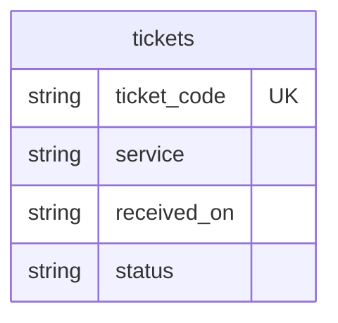

# Spreadsheet Import Lab

Bài thực hành 1–2 ngày với Python 3.12, SQLite và CSV giả lập. Giải nén ZIP rồi mở PowerShell trong thư mục có import_csv.py.

```powershell
python import_csv.py examples/first.csv
python import_csv.py examples/second.csv
python import_csv.py examples/second.csv
python import_csv.py examples/invalid.csv
python run_import.py --notebook
```

Ngày 1 đọc kết quả hai lượt đầu. Lần đầu thêm 2 phiếu. Lần sau thêm 1 và cập nhật 1. Ngày 2 thử lượt nhập lại giữ nguyên 2 dòng và file lỗi trả mã 1 ở dòng 3. Sau đó database vẫn có 3 phiếu.

Có thể nhấp đúp START_NOTEBOOK.cmd. Nhấn Shift+Enter từng ô. Notebook tạo database tạm mới từ ô đầu. Script mặc định dùng database/workshop.db và nhận --db để chọn bản thực hành khác. File nhập sau quyết định nội dung của mã phiếu xuất hiện trong file đó.



| Cột | Ý nghĩa |
|---|---|
| ticket_code | Mã phiếu dạng SC-001 |
| service | Dịch vụ sửa xe |
| received_on | Ngày nhận YYYY-MM-DD |
| status | pending, in_progress hoặc completed |

[Bài tập](docs/exercises.md) · [Lời giải](docs/solutions.md). Mã MIT.
